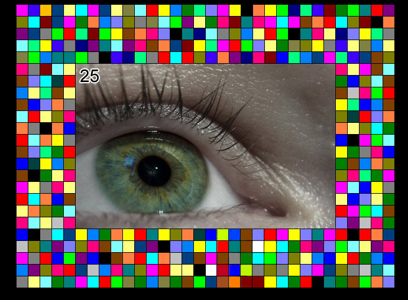
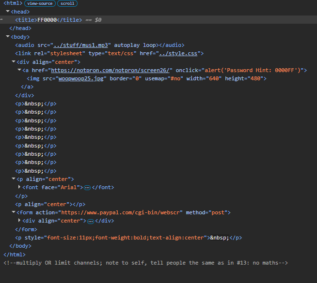
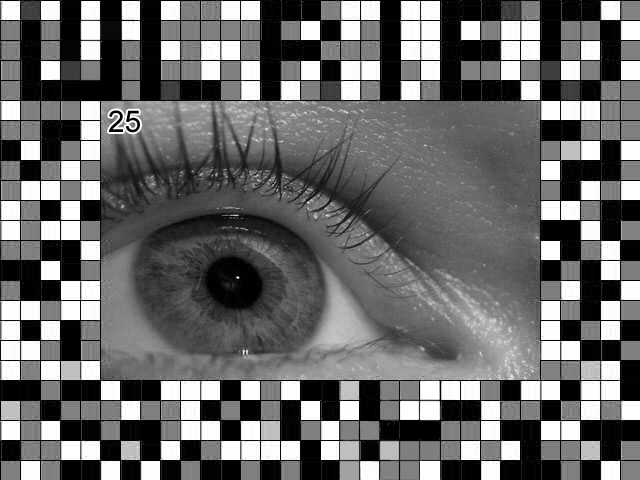
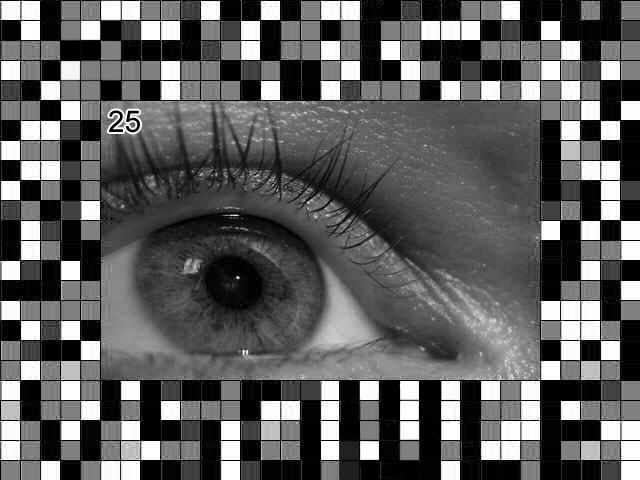

# Level 25

[Link level](https://notpron.com/notpron/beepbeep/xylophone.htm)

**Difficulty:** Medium

## Preview


## Solution
The idea behind this level was quite intuitive, in fact, after seeing the mosaic image, it was clear that I needed to manipulate the RGB values, in any case, as always, I opened the developer tools



Upon examining the code, it immediately becomes clear that the RGB values need to be addressed: the page title is FF0000 (corresponding to red), clicking the image returns 0000FF (corresponding to blue), and finally, there is a comment at the bottom of the page mentioning the channels, I therefore deduced, after several attempts, that I needed to isolate pixels of a specific color, which is why I wrote this short Python script.

```python
import cv2

img = cv2.imread("level25.jpg")

blue = img[:, :, 0]
green = img[:, :, 1]
red = img[:, :, 2]

cv2.imwrite("level_25_red_channel.png", red)
cv2.imwrite("level_25_blue_channel.png", blue)
```

Executing this code yields two very interesting images.





As you can see from the images, they contain the word WLRIED and the word VSOWLE, after trying to insert these credentials I realized that they did not work, and this is because they were the anagram of the words WILDER and WOLVES, after spending 30 minutes to understand the error and after realizing that they were anagrams I inserted the new credentials — and boom, level 25 completed!

---


_Time taken: 40 minutes_
